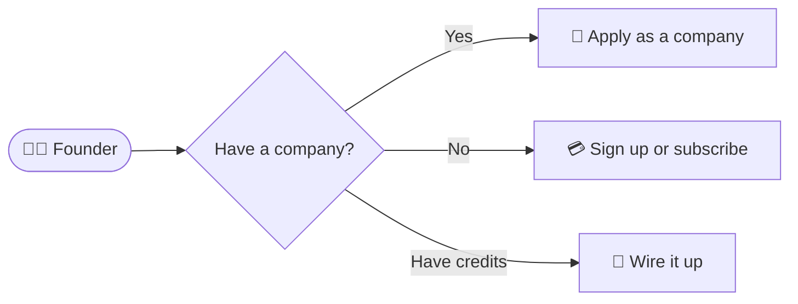

# 🚀 Startup credits

Find your credits, then apply.

    

Brand: [Colorado Startups brand guide](https://colorado-startups.github.io/brand/)

## 🚪 Three doors

| Door | Repo | For |
|---|---|---|
| 🚀 Apply as a company | [startup-credits](https://colorado-startups.github.io/startup-credits/) (this repo) | Startup credit programs |
| 💳 Sign up or subscribe | [Colorado-Compute/compute-credits](https://colorado-compute.github.io/compute-credits/), the Credits Explorer | Free credits and subsidized subscriptions anyone can get |
| 🔌 Wire it up | [SoulCraft-Org/compute-crafter](https://soulcraft-org.github.io/compute-crafter/) | Open-weight models in the OpenCode desktop app and Claude Code |

## 🚀 Apply in three steps

Every row was read on the provider's own page on its `checked` date. Programs close without notice, so read the source page first.

| Step | Do this |
|---|---|
| 1️⃣ Describe your startup | Copy [`match/examples/colorado-preseed-ai.json`](match/examples/colorado-preseed-ai.json) and set your stage, funding, company and needs. Leave a field `null` when you do not know it |
| 2️⃣ Get your short list | `python3 -I match/match.py my-startup.json` (Python 3, no installs) |
| 3️⃣ Apply | Work down the list. Each program prints its steps, its apply link and the page it was read on |

No Python? Read [the founder guide](guides/free-gpu-credits-for-founders.md), or filter [`catalog/programs.json`](catalog/programs.json) by `bucket`. No company? The matcher points you to the second door.

## 🪣 Two buckets

| Bucket | Means | Programs |
|---|---|---|
| 🏢 `incorporated` | Needs a registered company | 27 |
| 🤝 `funded_or_partner` | Needs outside funding, an investor or accelerator code, or an invitation | 18 |

## 🗺️ What is here

| Path | What it is |
|---|---|
| 📚 [`catalog/`](catalog/README.md) | `programs.json`, the 45 programs, and `check.py`, which guards every field |
| 🎯 [`match/`](match/README.md) | The matcher: profile in, short list out |
| 🧭 [`guides/`](guides/free-gpu-credits-for-founders.md) | The founder guide: what to apply for first, and how to avoid a surprise bill |
| 🎓 [`program/DESIGN.md`](program/DESIGN.md) | The Colorado Startups Accelerator Program, a free, non-equity cohort (not running yet) |
| 🛠️ `tools/` | The text checks and the secret scan |

## ✏️ Fix a program

Edit `catalog/programs.json` in a pull request. Update the row's `source` and `checked` to the page you read today. Run `python3 -I catalog/check.py --fix`, then `python3 -I catalog/check.py`. CI runs every check. Sign off each commit with `git commit -s`.

Colorado Startups is not a partner of any provider listed, and none paid to appear.

## ⚖️ License

Everything Colorado Startups wrote here is public domain under [CC0 1.0](LICENSE). The code (`tools/`, `match/match.py`, `catalog/check.py`, `.github/workflows/`) is also offered under [0BSD](LICENSES/0BSD.txt). Contributions come in under the same terms. Provider names and marks belong to their owners.
