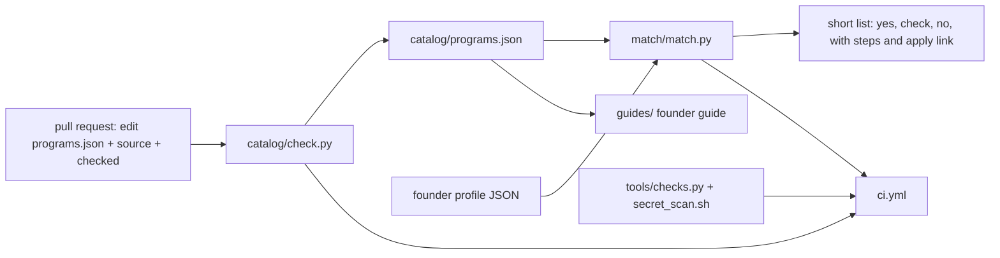

# startup-credits spec

The public catalog of free startup credit programs, the matcher that turns a founder's profile into a short list, and the founder guide.

| Row | Spec |
|---|---|
| Purpose | One source of program facts (`catalog/programs.json`), a stdlib matcher over it, a founder guide, and the design of a proposed accelerator (`README.md`) |
| Inputs | `catalog/programs.json` (keys `version`, `about`, `checked`, `buckets`, `rows`; 45 rows), and a founder's profile JSON copied from `match/examples/` (stage, funding, company, needs; `null` when unknown) |
| Outputs | A short list with a verdict per program (`yes`, `check`, `no`), its steps, its apply link and its source page (`match/match.py`), as text or `--json` |
| Interfaces | `python3 -I match/match.py PROFILE.json [--json]`, `--check-catalog`, `--self-test`. `python3 -I catalog/check.py [--fix] [--self-test]`. `python3 -I tools/checks.py [--self-test]`. `bash tools/secret_scan.sh`. Workflows `ci.yml` and `pages.yml`. No ports or env var names are stated in the repo |
| How to run | Founders: `python3 -I match/match.py my-startup.json` (Python 3, no installs). Maintainers: the six commands in `ci.yml` plus `bash tools/secret_scan.sh`. CI runs them through Git Crafter's `ci-standard.yml`. The repo states no rule about where else they run |
| Status | The README lists 45 programs, 27 `incorporated` and 18 `funded_or_partner`, counted from the catalog and checked 2026-11-12. `program/DESIGN.md` says the accelerator is a design, not running. No version tag, HANDOFF file or open-work list is stated in the repo |
| Done means | `ci.yml` is green. `tools/checks.py` finds every JSON file parsing, no em or en dash, no email address outside example domains, and no private path or `cs_*` or `evidence` key. `catalog/check.py` finds exact row fields, https links, dates, steps and canonical layout. `match.py --check-catalog` finds every row readable by the matcher, and its self-test passes its seeded cases. `secret_scan.sh` scans the full history with gitleaks 8.30.1 by checksum |

## Files that define behaviour

| File | Source of |
|---|---|
| `AGENTS.md` | Repo rules: first-party sources only, public fields only, shipping, writing style |
| `catalog/programs.json` | The one source of program facts, sorted by bucket, provider, program |
| `catalog/check.py` | The row allowlist (`ROW_FIELDS`), text rules and canonical bytes; `--fix` rewrites the layout |
| `catalog/README.md` | The row field definitions and what is public |
| `match/match.py` | The three verdicts and the rules each profile field is tested against |
| `match/README.md` | The profile shape |
| `match/examples/*.json` | Two sample profiles to copy |
| `tools/checks.py` | The text checks: json, dash, email, private |
| `tools/secret_scan.sh` and `gitleaks_gate.sh` | The history-wide secret scan and its exit codes |
| `guides/free-gpu-credits-for-founders.md` | The founder guide |
| `program/DESIGN.md` | The proposed Colorado Startups Accelerator Program design (status: design, not running) |
| `.github/workflows/ci.yml` | The checks in "Done means" |

## Related repos

| Repo | Relation |
|---|---|
| [Colorado-Compute/compute-credits](https://github.com/Colorado-Compute/compute-credits) | Credits anyone can get with no company needed (cloud trials and free tiers) |
| SoulCraft-Org/git-crafter | Supplies the `ci-standard.yml` workflow CI uses |

## Not in scope

| Item | Note |
|---|---|
| Application drafts, account records, contact data, `cs_*` and `evidence` fields | Kept out of this public repo, and `tools/checks.py` refuses them (`AGENTS.md`) |
| Provider acceptance | Meeting the rules is not acceptance: the provider decides (`match/match.py`) |

Read on 2026-11-25 from the repo's default branch at 50b11d0.
